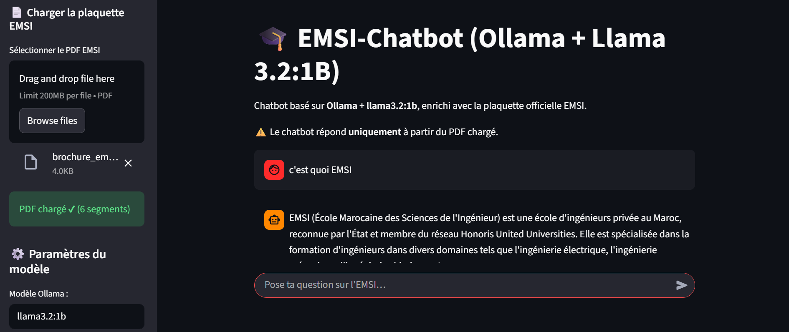
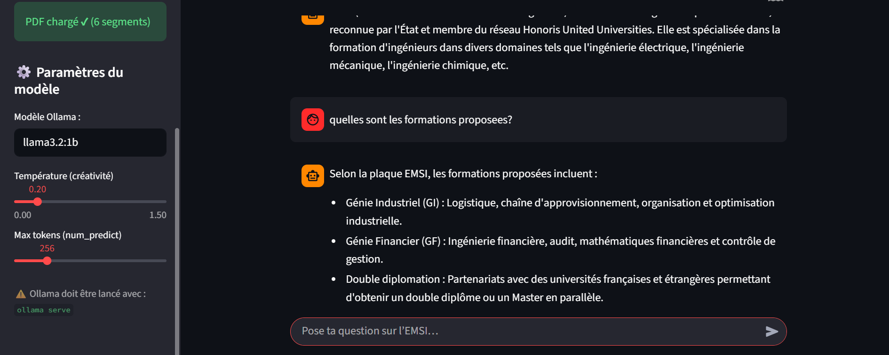

# 🎓 EMSI RAG Chatbot (FastAPI + Ollama Llama 3.2 + Streamlit)

Application conversationnelle intelligente basée sur l'architecture **RAG (Retrieval-Augmented Generation)**. Le système permet d'importer une plaquette institutionnelle au format PDF, d'extraire et segmenter son contenu, puis d'interroger un grand modèle de langage local (**Ollama / Llama 3.2:1b**) pour obtenir des réponses strictes, contextuelles et sécurisées.

## 🚀 Fonctionnalités Clés
* **Traitement et Segmentation de PDF :** Chargement dynamique des documents, extraction du texte brut et découpage intelligent par segments (*chunking*)[cite: 15].
* **Recherche Contextuelle (Retrieval) :** Algorithme de similarité textuelle ciblant précisément les segments pertinents du document pour nourrir le modèle.
* **Architecture 3-Tiers :** 
  * Un backend robuste basé sur **FastAPI** pour traiter la logique RAG et communiquer avec le LLM.
  * Une interface utilisateur interactive sous forme de chat développée avec **Streamlit**[cite: 15].
* **Paramétrage Avancé :** Contrôle dynamique de la température (créativité) et du nombre de tokens directement depuis la barre latérale[cite: 16].

## 🛠️ Stack Technique
* **Backend :** FastAPI, Python, Uvicorn
* **Interface Web :** Streamlit[cite: 15]
* **Traitement Documentaire :** PyPDF2
* **Intelligence Artificielle & NLP :** Ollama (Llama 3.2:1b), Requêtes HTTP REST[cite: 15]

## 📊 Aperçu de l'Application

**1. Importation du document et première interaction (Présentation de l'établissement) :**


**2. Consultation thématique précise (Extraction des formations proposées) :**


## ⚙️ Comment lancer le projet en local ?

### 1. Prérequis (Ollama)
Assurez-vous d'avoir installé [Ollama](https://ollama.com) et de lancer le modèle localement :
```bash
ollama run llama3.2:1b
